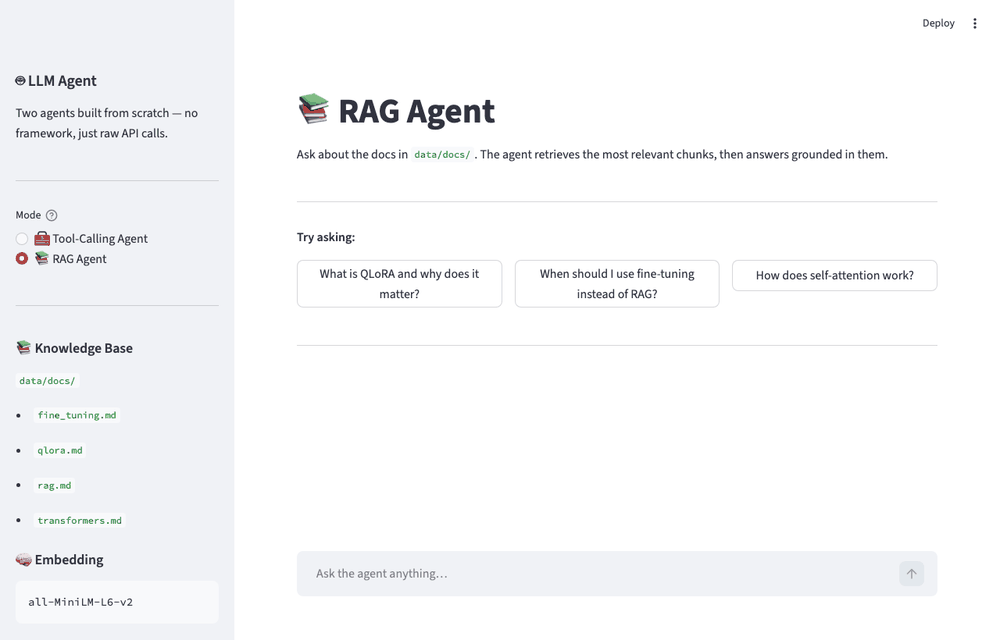

# LLM-from-scratch

A hands-on learning repo for building, fine-tuning, and deploying large language models and AI agents from the ground up. Everything here is built step by step — no black boxes.

---

## Live Demo

Two agents in one Streamlit app — switch modes from the sidebar.



| 📚 RAG Agent | 🧰 Tool-Calling Agent |
|---|---|
| Retrieves relevant chunks from `data/docs/` and answers grounded in them, with citations | Picks the right tool (calculator, weather, word count) and chains them automatically |

> **Run it locally:**
> ```bash
> conda activate llm-lab
> python -m streamlit run app.py
> ```
> Requires a `GROQ_API_KEY` in your `.env` file. The RAG mode auto-ingests `data/docs/` on first run.

---

## Goal

The goal is to go from zero to being able to:
- Fine-tune open-source LLMs on custom datasets
- Build tool-calling agents that interact with real APIs and data
- Deploy models and agents in production

Everything runs on a Mac (Groq API for LLMs, Apple MLX for local models). The HPC/SLURM track was dropped.

**Where to look:**
- [`ROADMAP.md`](ROADMAP.md) — the 1-month plan, mapped to 25 AI-engineer interview problems
- [`NOTES.md`](NOTES.md) — short revision notes per topic (slide-ready)

---

## Progress

A 1-month plan, built around 25 common AI-engineer interview problems. Full plan in
[`ROADMAP.md`](ROADMAP.md). Short revision notes for every topic in [`NOTES.md`](NOTES.md).

| Week | Topic | Status |
|---|---|---|
| 1 | Agents: reliability, loops, tracing, memory | ✅ done |
| 2 | RAG: chunking, hybrid search, reranking, evals | 🔨 next |
| 3 | Fine-tuning: local inference with MLX, LoRA, base vs tuned | ⬜ |
| 4 | Reliability and safety: JSON, hallucination, evals, judges, injection, PII, rollback | ⬜ |
| 5 | Cost, speed, serving, system design | ⬜ |

After that: optional extras (web search tool, LangGraph version, tiny GPT from scratch, deployment).

### Interview problems answered so far

Each topic is one of 25 common AI-engineer interview questions. Short answers below; the
full list of 25 is in [`ROADMAP.md`](ROADMAP.md).

| Problem | How we answered it (in code) |
|---|---|
| Build an agent that uses tools reliably | Safe calculator (AST whitelist, no `eval`), timeouts, tool errors returned as text, argument validation against the tool schema, fixed duplicate-message bug (`agents/safe_calc.py`, `tool_utils.py`) |
| Your agent gets stuck in a loop. Fix it | Hard `MAX_STEPS` limit plus repeat-call detection; tested with a fake stuck model (`agents/basic_agent.py`) |
| Design memory for a long-running assistant | Short-term window + rolling summary + per-user long-term vector memory; only cut history at user messages (`agents/memory.py`) |
| Trace every step of a multi-agent workflow | Span-based tracer: inputs, outputs, latency, tokens, errors, saved as JSON (`agents/tracer.py`) |
| Block prompt injection in a tool-using agent *(partly)* | Why `eval` on model output is dangerous; whitelist approach |

**Still to come:** RAG at scale, debugging bad RAG answers, chunking, BM25 vs dense vs hybrid,
rerankers, cutting LLM cost, first-token latency, semantic cache, model routing, valid JSON
output, hallucinations, eval suites, LLM-as-judge, PII redaction, fine-tune vs RAG vs prompting,
LoRA fine-tuning, serving at scale, SSE streaming, prompt rollback, and ChatGPT-style system design.

---

## What's In The Code

### Agents — `agents/`

Built from scratch with the Groq API and Llama 4 Scout. No frameworks.

- `basic_agent.py` — tool-calling loop (calculator, word_count, weather) with step limit, repeat detection and tracing
- `rag_agent.py` — chunk → embed → ChromaDB → retrieve → grounded answer with citations
- `safe_calc.py` — whitelist-based math evaluator
- `tool_utils.py` — validates model arguments against the tool schema
- `tracer.py` — spans and traces for debugging
- `memory.py` — conversation memory (window + summary) and long-term vector memory

The key idea: the model never runs code. It reads tool descriptions, decides what to call,
and your Python does the work. The model is the brain. Your code is the hands.

### Training — `training/`

`inference.py` loads `Qwen2.5-0.5B-Instruct` from HuggingFace and generates text. Fine-tuning
(LoRA with Apple MLX, on the Mac) is planned for Week 3. The earlier SLURM/HPC track was dropped.

---

## Repo Structure

```
LLM-from-scratch/
├── agents/          # agents, tools, tracer, memory
├── training/        # inference (fine-tuning planned)
├── data/docs/       # sample knowledge base for RAG
├── traces/          # saved agent traces (git-ignored)
├── app.py           # Streamlit demo (RAG + tool agent)
├── ROADMAP.md       # the 1-month plan
├── NOTES.md         # revision notes per topic (slide-ready)
└── requirements.txt
```

---

## Model Families

Open-source LLMs come from several major families. The ones used or planned in this repo:

| Family | Made by | Known for |
|---|---|---|
| **Llama** | Meta | Most popular open-source family, powers most of the OSS ecosystem |
| **Qwen** | Alibaba | Strong at coding and math, what we use for training |
| **Gemma** | Google | Lightweight, runs on smaller hardware |
| **Mistral** | Mistral AI | Efficient, punches above its weight |

The size of a model is measured in parameters — the numbers learned during training:

```
0.5B   →  tiny, fast, good for learning
7–8B   →  sweet spot for fine-tuning on a single GPU
70B    →  high quality, needs multiple GPUs
```

---

## Tech Stack

**Language & Environment**


**LLM APIs & SDKs**


**Agent Frameworks**


**Vector Store / RAG**


**Model Training & Fine-tuning**


**Apple Silicon**


**Infrastructure**


---

## Setup

**Mac (agent development):**
```bash
conda activate llm-lab
pip install -r requirements.txt
```

**HPC (model training):**
```bash
module load anaconda
conda activate llm-lab
```

Create a `.env` file in the repo root for API keys — never commit this file:
```
GROQ_API_KEY="gsk_..."
HF_TOKEN="hf_..."
```